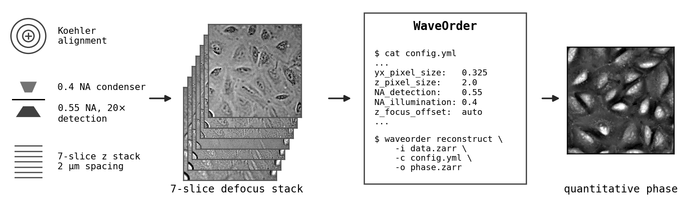
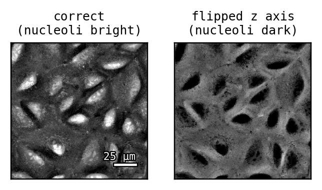
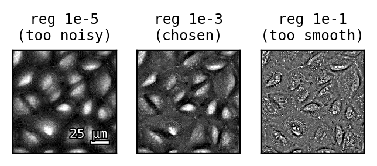
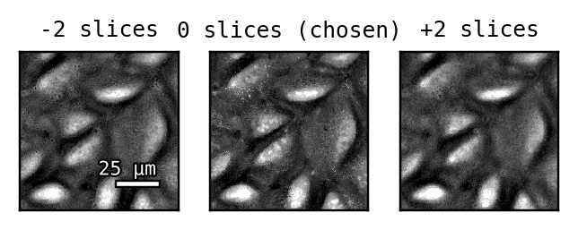
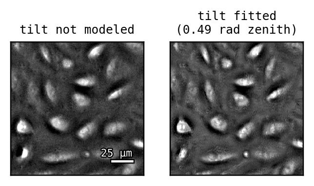

# WaveOrder for label-free high-throughput screening



This guide demonstrates WaveOrder for label-free high-throughput screening
using optical pooled screening (OPS) data from the
[Biohub's multimodal perturbation atlas](https://www.biorxiv.org/content/10.64898/2026.06.01.728087v1)
[1], where phase from defocus enabled label-free tracking and phenotyping of
CRISPR-perturbed A549 cells. Brightfield defocus stacks from a standard
motorized widefield microscope, together with a
[WaveOrder](https://github.com/biohub/waveorder) config [2], yield
quantitative phase at screening scale (see the overview figure).

After reading this guide and acquiring data, use the
[first-reconstruction guide](../first-reconstruction.md) and connect your
agent to the [Biohub MCP](https://biohub.ai/mcp) to run the
`waveorder-tutorial` skill. Methods are described in the
[WaveOrder preprint](https://arxiv.org/abs/2412.09775) [3].

## Acquisition

The three settings that matter most are:

- **Koehler illumination.** Align the condenser before every session.
  Misalignment is the most common source of artifacts. Ron Vale's
  five-minute
  [iBiology tutorial](https://www.ibiology.org/talks/set-up-koehler-illumination/)
  [4] is a good refresher.
- **Condenser NA of roughly 2/3 the detection NA.** We used a 0.4 NA
  condenser and a 0.55 NA objective. A larger condenser aperture reduces
  contrast, while a smaller condenser aperture reduces contrast and
  resolution.
- **Z spacing and range.** At 20x, start at 2 µm spacing and cover the full
  cell height with visibly blurred features on either end of the stack
  (here, 7 slices = 12 µm). For different objectives, scale inversely with
  magnification: e.g. 4 µm at 10x, 1 µm at 40x.

| Parameter | Perturbation atlas value | Notes |
| --- | --- | --- |
| Objective | 20x, 0.55 NA, air | any objective works; match the config |
| Condenser | 0.4 NA | ~2/3 of detection NA, Koehler aligned |
| Z stack | 7 slices, 2 µm | confirm defocused features on top and bottom slices; use more slices for thicker samples |
| Camera | 6.5 µm pixels | 6.5 µm / 20x = 0.325 µm at the sample |
| Wavelength | 450 nm | any wavelength is fine; ideally use a 10 nm notch filter |
| Exposure | a few ms | fill 1/2-2/3 of the dynamic range |

## Reconstruction

Convert to OME-Zarr with [iohub](https://github.com/czbiohub-sf/iohub)
(`iohub convert -i <dataset> -o data.zarr`), then record the acquisition
parameters in a file named `config.yml`:

```yaml
input_channel_names: [BF]
reconstruction_dimension: 2
phase:
  transfer_function:
    yx_pixel_size: 0.325  # 6.5 um / 20x
    z_pixel_size: 2.0
    wavelength_illumination: 0.450
    index_of_refraction_media: 1.0
    numerical_aperture_detection: 0.55
    numerical_aperture_illumination: 0.4
    invert_phase_contrast: false
    z_focus_offset: auto
  apply_inverse:
    regularization_strength: 0.001
```

Reconstruct one position and compare it to the raw data in napari:

```bash
waveorder reconstruct -i data.zarr/A/1/029029 -c config.yml -o phase.zarr
waveorder view data.zarr/A/1/029029 phase.zarr/A/1/029029
```

Dense structures (nucleoli, nuclear envelopes, cell margins) should appear
brighter than background, as in the overview figure.
`reconstruction_dimension: 2` returns one phase image per defocus stack, the
best choice for samples that are thin compared to the depth of field of the
microscope. If the sample appears to blur all at once as you defocus, use 2.
If different regions of the sample blur at different defocus positions,
consider trialling 3.

## Failure modes and their fixes

**Failure mode 1 | Flipped z axis.** Stages disagree on the z sign
convention (is the first slice above or below focus?). If the convention is
flipped, contrast will be inverted and downstream comparison will be
challenging. Dense organelles should be bright. Fix:
`invert_phase_contrast: true`. Check once per microscope by reconstructing
one stack both ways.



**Failure mode 2 | Incorrect regularization.** `regularization_strength`
balances noise and resolution and varies by orders of magnitude across
samples and exposures. Sweep decades on one position and choose manually.
Too small amplifies blotchy low-frequency noise; too large leaves a
washed-out image. The optimum is usually within a decade of `1e-3`.

```bash
for reg in 1e-5 1e-4 1e-3 1e-2 1e-1; do
  sed "s/regularization_strength: .*/regularization_strength: $reg/" config.yml > config_$reg.yml
  waveorder reconstruct -i data.zarr/A/1/029029 -c config_$reg.yml -o phase_$reg.zarr
done
waveorder view phase_*.zarr/A/1/029029
```



**Failure mode 3 | Autofocus drift.** When the stack center (e.g. the 4th
slice in a 7 slice stack) is not in focus, the reconstruction will be
blurry. Setting `z_focus_offset: auto` runs the search that can recover the
defocus offset:

```
$ waveorder reconstruct -i data.zarr/A/1/029029 -c config.yml -o phase.zarr
Resolving z_focus_offset with a per-slice focus search...
Resolved z_focus_offset = 0 (slice units) from the data; per-crop focus slices [3, 3, 3, 3, 3]
```



**Failure mode 4 | Tilted illumination at the well edge.** Misaligned
Koehler and imaging near a well-edge meniscus tilts the illumination, making
cells look shadow-cast with reduced contrast. Fit the tilt by gradient
descent in the same config:

```yaml
# inside phase.transfer_function:
    z_focus_offset: auto
    tilt_angle_zenith: {init: 0.13, lr: 0.05}
    tilt_angle_azimuth: {init: 0.0, lr: 0.05}
# and at the top level:
optimization:
  max_iterations: 50
  method: adam
```



## Scaling up

A single config file should generate good reconstructions across a screen.
We suggest parallelizing `waveorder reconstruct` over positions (one process
or cluster job per position) with `device: cuda:0` to reconstruct on a GPU.
We recommend `z_focus_offset: auto` to find the focus of each position.

We recommend manual supervision to set up the optimized
`tilt_angle_{zenith,azimuth}` parameters across entire wells. We find that
initializing these tilt parameters at good initial tilts generates the
stablest reconstructions, so we recommend inspecting reconstructions at the
well edges, then refining the initial values until you reach stable
reconstructions that pass QC.

## References

1. C. Liu, A. V. Hillsley, M. Sekhar, et al., "A Multimodal Perturbation
   Atlas Defines the Phenotypic Resolution of Cellular Morphology,"
   [bioRxiv 2026.06.01.728087](https://www.biorxiv.org/content/10.64898/2026.06.01.728087v1).
2. WaveOrder repository:
   [github.com/biohub/waveorder](https://github.com/biohub/waveorder).
3. T. Chandler, I. E. Ivanov, G. Sturm, et al., "WaveOrder: A differentiable
   wave-optical framework for scalable biological microscopy with diverse
   modalities," [arXiv:2412.09775](https://arxiv.org/abs/2412.09775).
4. R. Vale, "Microscopy: Setting Up Koehler Illumination,"
   [iBiology Microscopy Series](https://www.ibiology.org/talks/set-up-koehler-illumination/).
